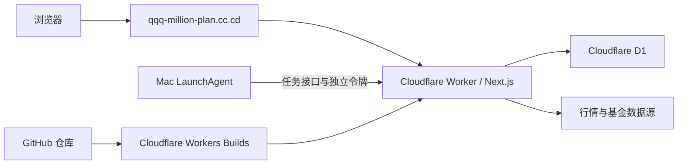

# 部署方案与当前流程

更新日期：2026-10-30。本文以本项目的当前配置为例；各平台的价格、免费额度和功能限制可能变化，请以文末官方文档为准。

## 一、项目部署需要解决什么

本项目是 Next.js 全栈应用：除了网页，还需要执行服务端代码、保存持仓和定投等数据，以及定期更新行情和基金资料。部署方案需要同时考虑：

1. **网站运行**：用户能通过域名访问页面和接口。
2. **持久化数据库**：重启或重新部署后，财务数据仍然存在。
3. **定时任务**：按计划触发定投补记、行情及基金资料更新。
4. **构建发布**：代码修改后如何构建、部署和验证。

## 二、可选方案

### 方案 A：Cloudflare Workers + D1 + 本机定时任务（当前采用）

- 使用 OpenNext 将 Next.js 项目构建为 Worker，由 Cloudflare 托管。
- 使用 Cloudflare D1 保存数据；D1 基于 SQLite，与项目原有本机 SQLite 的数据模型比较接近。
- 目前由 Mac 上的 LaunchAgent 定时调用受独立令牌保护的云端接口。
- **当前状态**：网站和 D1 已上线；Mac 关机时网站仍可访问，但由 Mac 触发的自动更新会暂停。

### 方案 B：Cloudflare Workers + D1 + 云端定时任务

在方案 A 的基础上，把本机调度改为 Cloudflare Cron Triggers 等云端触发方式。这样更新不再依赖 Mac，但需要额外改造任务调度，处理执行时间、分批、重复触发及失败重试，并完成测试。**本项目尚未采用这一方案。**

### 方案 C：Cloudflare Pages + Pages Functions + D1

Pages 可托管网站资源，并通过 Pages Functions 执行服务端逻辑，再连接 D1。静态网站适合使用 Pages；本项目包含动态页面、服务端操作和数据库写入，仍需适配及验证。Cloudflare 目前对全栈 Next.js 推荐 Workers 方案；本项目已有经过适配的 OpenNext + Workers 实现，重新改为 Pages 会带来额外迁移工作。

### 方案 D：Vercel + Supabase / Neon

使用 Vercel 运行 Next.js，使用 Supabase 或 Neon 提供 PostgreSQL 数据库。Next.js 与 Vercel 集成较直接，可连接 Git 自动构建并生成预览。

当前数据在 D1/SQLite 中，迁往 PostgreSQL 需要转换表结构和数据，并调整数据库查询、事务和相关测试；不能只更换数据库地址。Vercel 的定时任务也需要重新配置：Hobby 免费版每个任务最频繁每天一次，触发时间可能在指定小时内浮动，不能直接替代目前每 30 分钟的检查频率。

### 方案 E：自有服务器 / 云主机 + SQLite

在持续运行的服务器上部署 Node.js 应用，将 SQLite 放在持久磁盘上；可使用反向代理、HTTPS 或 Cloudflare Tunnel 提供访问。

优点是接近项目原有的 Node.js + SQLite 运行模式；缺点是需要自己维护服务器、系统更新、备份、安全和服务进程。若运行在自己的 Mac 上，网站可用性取决于 Mac 开机、联网和不休眠；若使用云主机，需考虑主机与存储费用。

## 三、方案对比

| 维度 | A：Workers + D1 + Mac | B：Workers + D1 + 云端定时 | C：Pages + Functions + D1 | D：Vercel + PostgreSQL | E：服务器 + SQLite |
| --- | --- | --- | --- | --- | --- |
| 网站和数据是否依赖 Mac | 否 | 否 | 否 | 否 | 如果部署在 Mac 上则依赖 |
| 定时更新是否依赖 Mac | 是 | 否 | 取决于另配的调度方式 | 取决于 Cron 或外部调度方式 | 取决于运行服务器 |
| 数据库 | D1 / SQLite | D1 / SQLite | D1 / SQLite | PostgreSQL，如 Supabase 或 Neon | 持久磁盘上的 SQLite |
| 相对当前项目的工作量 | 已完成主要适配 | 需迁移和验证定时任务 | 需重新验证 Next.js 兼容性 | 需迁移数据库、查询和任务 | 需搭建与维护主机环境 |
| 服务器维护 | 平台管理 | 平台管理 | 平台管理 | 平台管理，数据库由供应商提供 | 需自行维护主机 |
| 适合场景 | 沿用已上线方案，接受 Mac 调度 | 希望自动更新不依赖 Mac | 以静态内容为主的网站 | 更重视 Vercel 的 Next.js 开发体验 | 需要完整 Node.js 和自主管理运行环境 |

费用不能只按平台名称比较：需要分别核对函数调用、数据库读写与存储、流量、构建和定时任务等额度。两边均有免费方案，但免费额度和超额处理规则不同。

## 四、当前采用方案 A 的原因

1. **网站已独立于 Mac 运行**：网页和数据库都在 Cloudflare；Mac 只负责目前的任务触发。
2. **数据迁移相对顺畅**：原项目使用 SQLite，D1 也采用 SQLite；迁移仍需异步 API、事务和运行时适配，但不必同时转换为 PostgreSQL。
3. **已有可用实现**：当前 Worker 已绑定 D1、自定义域名和任务接口，迁移工作及主要验证已完成。
4. **减少日常运维**：无需为网站维护一台始终运行的服务器；发布可由 Wrangler 或已配置的 Cloudflare Workers Builds 完成。
5. **保留后续改进空间**：如果希望 Mac 关机后仍自动更新，可以单独评估迁移到云端定时触发，而不必立即更换网站和数据库。

当前取舍是：方案 A 的自动更新仍依赖 Mac，且 Worker / D1 的使用受账户套餐限制。按现有设置网站无需登录，知道网址的人可以查看和修改财务数据；跨站写入检查和任务接口令牌不能代替网站访问认证。

## 五、当前部署流程

### 5.1 组成与请求路径



- **域名**：`https://qqq-million-plan.cc.cd`；Cloudflare 区域已启用 HTTP 到 HTTPS 跳转。
- **Worker**：`qqq-million-plan`；构建配置和 D1 绑定见 [wrangler.jsonc](../wrangler.jsonc)。
- **数据库**：D1 `personal-finance-db`，是上线后的主要数据源。
- **自动更新**：本机 LaunchAgent `com.wxxiao6.finance-cloud-jobs` 每 30 分钟运行一次检查。脚本会检查到期定投，并在北京时间 22:00 后检查每日行情更新、周一 01:00 后检查基金概况更新；失败后的重试取决于后续调度和 Mac 状态。
- **访问控制**：当前代码中的网站不要求登录；任务接口使用独立的 `CLOUD_JOB_TOKEN`。额度上报接口另外需要配置其令牌和来源域白名单。

### 5.2 已完成的数据迁移

1. 停止旧的本地开发服务，使用 SQLite 在线备份生成一致性副本。
2. 检查备份完整性及外键，将 33 张表（包括历史表）导出为 D1 可导入的 SQL。
3. 导入空的生产 D1 后，从云端重新导出，恢复到隔离 SQLite 并逐表核对内容及自增序列。
4. 将 Worker 绑定到 D1，验证页面、任务接口和部分真实行情同步。

迁移时的本地备份为 `data/backups/cloud-final.sqlite`；它不会自动包含迁移后产生的线上新数据。线上 D1 才是当前主要数据源。备份、令牌和本地数据文件不应提交到 Git。

### 5.3 自动构建与手动发布

项目的历史部署记录显示，Worker 已连接 GitHub `main`，Cloudflare Workers Builds 的配置为：

```text
构建：DISABLE_JOBS=1 pnpm run build:cloudflare
部署：pnpm exec opennextjs-cloudflare deploy
```

代码推送后，应在 Cloudflare 的构建记录中确认对应提交是否构建和部署成功；配置了连接本身不等于每次构建都成功。发布普通代码不会重新导入 D1 数据；涉及数据库表结构变更时，需要单独设计迁移与备份。

也可以在项目目录手动执行：

```bash
pnpm test
P0_TEST_DB="$(mktemp -d)/build.sqlite" pnpm build:cloudflare
pnpm exec wrangler deploy
```

手动构建中的临时数据库用于避免构建过程使用旧的本机账本；它不会替代线上 D1。发布后应检查网站、数据库绑定、任务接口及相关功能。

## 官方资料

- [Cloudflare：Next.js on Workers](https://developers.cloudflare.com/workers/framework-guides/web-apps/nextjs/)
- [Cloudflare：D1 本地开发与远程绑定](https://developers.cloudflare.com/d1/best-practices/local-development/)
- [Cloudflare：D1 定价与额度](https://developers.cloudflare.com/d1/platform/pricing/)
- [Vercel：Cron 任务额度与频率](https://vercel.com/docs/cron-jobs/usage-and-pricing)
- [Vercel：Postgres 集成](https://vercel.com/docs/postgres)
- [Supabase：项目数据库](https://supabase.com/docs/guides/platform/compute-and-disk)
